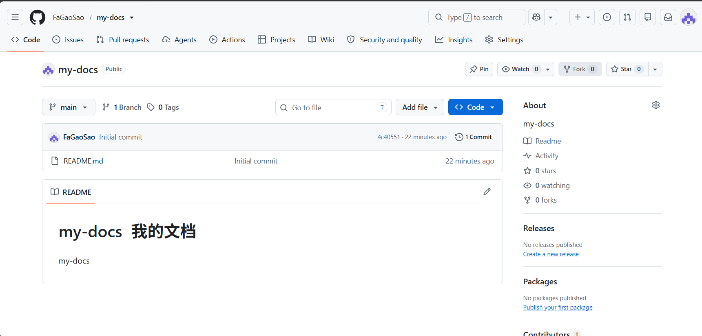
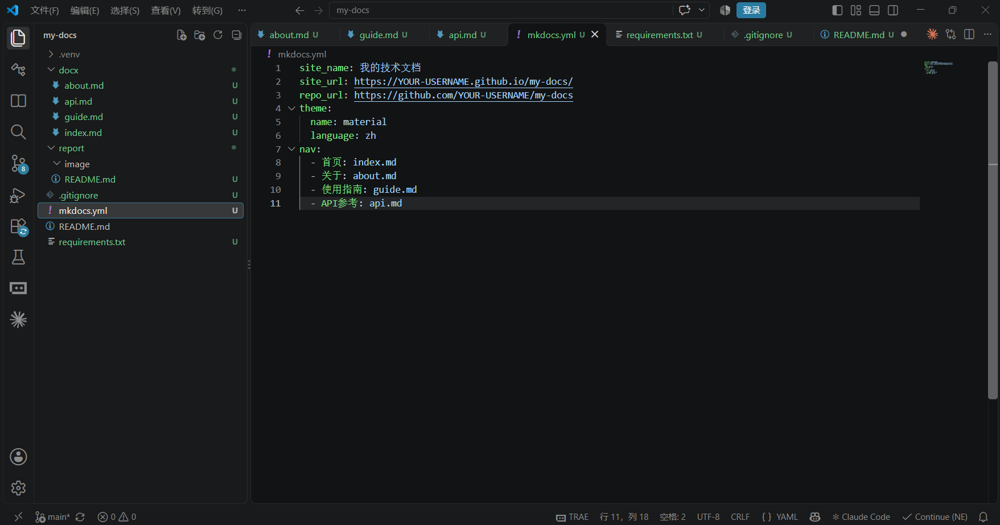
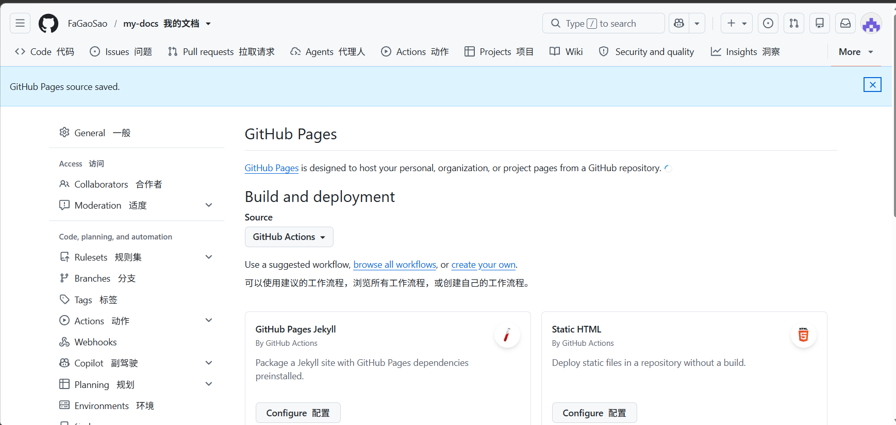
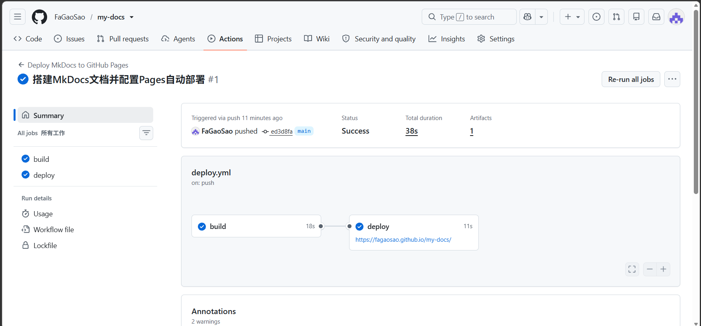

# 实践项目2：个人实验报告

## 1. 基本信息

- GitHub 登录名：FaGaoSao
- 个人仓库地址：https://github.com/FaGaoSao/my-docs
- 最终网站地址：https://fagaosao.github.io/my-docs/
- 个人作业地址（本文件）：https://github.com/FaGaoSao/my-docs/blob/main/report/README.md

## 2. 实践过程与关键截图

### 2.1 仓库创建

登录 GitHub 后点击右上角 `+` → `New repository`，Owner 选择本人账号 `FaGaoSao`，仓库名填 `my-docs`，可见性选择 **Public**，勾选添加 README 后创建。

创建后确认默认分支为 `main`，再点击 `Code` 复制 HTTPS 克隆地址，在本地执行：

```bash
git clone https://github.com/FaGaoSao/my-docs.git
cd my-docs
git branch --show-current
```

**做了什么、为什么这样做：** 先在 GitHub 上建公开仓库再克隆到本地，是为了让本地目录从一开始就与远程仓库关联，后续可以直接 `git push`，省去手动配置远程地址的步骤。仓库必须设为 Public，因为 GitHub Pages 的免费站点功能要求仓库公开，否则网站无法被外部访问。

**结果：** 仓库创建成功，所有者为 `FaGaoSao`，公开可见，默认分支为 `main`，本地克隆完成。



### 2.2 项目结构与 MkDocs 配置

在仓库根目录创建以下结构：

```
my-docs/
├── .github/
│   └── workflows/
│       └── deploy.yml
├── docs/
│   ├── index.md
│   ├── about.md
│   ├── guide.md
│   └── api.md
├── report/
│   ├── README.md
│   └── image/
├── mkdocs.yml
├── requirements.txt
├── .gitignore
└── README.md
```

`mkdocs.yml`：

```yaml
site_name: 我的技术文档
site_url: https://FaGaoSao.github.io/my-docs/
repo_url: https://github.com/FaGaoSao/my-docs
theme:
  name: material
  language: zh
nav:
  - 首页: index.md
  - 关于: about.md
  - 使用指南: guide.md
  - API参考: api.md
```

`requirements.txt`：

```
mkdocs>=1.6,<2
mkdocs-material>=9.6,<10
```

`.gitignore`：

```
site/
.venv/
__pycache__/
```

**关于 `docs`、`nav`、`site/` 作用的说明：**

- **`docs/`** 保存网站的**源内容**，即我手写的四个 Markdown 文件。它是整个项目里唯一需要人工编辑的对象，页面文字、表格、代码示例都来自这里。
- **`nav`** 定义导航栏的标题和排列顺序。它的路径是相对于 `docs/` 的，所以写 `index.md` 而不是 `docs/index.md`；如果写错，MkDocs 在 `--strict` 模式下会直接报错。另外 YAML 只能使用空格缩进，用 Tab 会导致解析失败。
- **`site/`** 是执行 `mkdocs build` 后自动生成的**静态网站产物**（HTML/CSS/JS）。它不是源码而是编译结果，因此写进 `.gitignore` 不提交到仓库——一方面它每次构建都会被完整覆盖，手工修改没有意义；另一方面提交进去只会让仓库变得臃肿。



### 2.3 本地构建或预览

在独立虚拟环境中安装依赖：

```bash
python -m venv .venv
.\.venv\Scripts\Activate.ps1
python -m pip install -r requirements.txt
python -m mkdocs build --strict
python -m mkdocs serve
```

**为什么用虚拟环境：** 把本项目的依赖装在独立环境里，避免与系统中其他 Python 项目的包版本互相干扰。本次实际安装版本为 `mkdocs 1.6.1` 与 `mkdocs-material 9.8.2`。

**为什么先 `build --strict` 再 `serve`：** `--strict` 模式会把警告当作错误处理，能在本地就拦住内部链接失效、导航条目缺失这类问题，而不是等推到远程后在 Actions 里才发现失败。

本地预览地址为 `http://127.0.0.1:8000/`，我逐个打开四个页面并检查了以下内容：

- 首页、关于、使用指南、API 参考四页均能正常打开，无空白页
- 左侧导航栏四个条目都能点击跳转，标题与 `nav` 配置一致
- 关于页的「技术组成」表格渲染为正常表格，而非纯文本的竖线
- API 参考页的 JSON 代码块带语法高亮和边框
- 首页底部到其余三页的链接均可正常跳转

检查完成后按 `Ctrl+C` 停止预览服务。


### 2.4 Pages 设置

在个人作业仓库进入 `Settings` → `Pages` → `Build and deployment` → `Source`，选择 **GitHub Actions**。

**为什么选 GitHub Actions 而不是分支发布：** 这次使用官方 Pages Actions 工作流，构建产物通过 artifact 机制直接交付给 Pages 服务。这样既不需要额外维护 `gh-pages` 分支，也不需要开启「允许 Actions 创建和批准 PR」的权限，更不需要自己申请访问令牌。工作流中已用 `permissions` 明确声明了 `pages: write` 与 `id-token: write`，因此仓库的默认权限保持只读即可，无需改成全局读写。



### 2.5 Actions 首次构建和部署

工作流文件 `.github/workflows/deploy.yml` 完整内容如下（`${{ ... }}` 表达式保持原样，未替换成账号）：

```yaml
name: Deploy MkDocs to GitHub Pages

on:
  push:
    branches: [main]
    paths:
      - 'docs/**'
      - 'mkdocs.yml'
      - 'requirements.txt'
      - '.github/workflows/deploy.yml'
  workflow_dispatch:

permissions:
  contents: read

concurrency:
  group: pages
  cancel-in-progress: false

jobs:
  build:
    runs-on: ubuntu-latest
    steps:
      - name: Checkout source
        uses: actions/checkout@v7

      - name: Set up Python
        uses: actions/setup-python@v7
        with:
          python-version: '3.12'

      - name: Configure Pages
        uses: actions/configure-pages@v5

      - name: Install dependencies
        run: python -m pip install -r requirements.txt

      - name: Build documentation
        run: python -m mkdocs build --strict

      - name: Upload site artifact
        uses: actions/upload-pages-artifact@v4
        with:
          path: site

  deploy:
    needs: build
    runs-on: ubuntu-latest
    permissions:
      pages: write
      id-token: write
    environment:
      name: github-pages
      url: ${{ steps.deployment.outputs.page_url }}
    steps:
      - name: Deploy to GitHub Pages
        id: deployment
        uses: actions/deploy-pages@v4
```

提交并推送：

```bash
git status
git add docs mkdocs.yml requirements.txt .gitignore .github/workflows/deploy.yml README.md
git diff --staged
git commit -m "搭建MkDocs文档并配置Pages自动部署"
git push origin main
```

**为什么提交前先 `git status` 和 `git diff --staged`：** 确认暂存区里只包含源码和配置，没有把虚拟环境 `.venv/` 或构建产物 `site/` 误提交进去。

**首次运行结果：** Run #1 由 push 自动触发并成功完成，`build` 耗时 18 秒、`deploy` 耗时 11 秒，两个任务均为绿色对勾，上传的部署产物 `github-pages` 大小为 582 KB。部署记录中的站点地址为 `https://fagaosao.github.io/my-docs/`。

- 首次运行链接：https://github.com/FaGaoSao/my-docs/actions/runs/45777435659
- 对应提交：https://github.com/FaGaoSao/my-docs/commit/ed3d8fa5644cd1b2684a228a2a01469bba59ac8d



### 2.6 网站访问与四页导航检查

从部署记录中获取站点地址：`https://fagaosao.github.io/my-docs/`。

**本机访问情况说明：** 在我所在的网络环境下，直接访问该地址出现连接超时（浏览器报 `ERR_CONNECTION_TIMED_OUT`），多次重试均未能打开。经排查，这属于本机到 GitHub Pages 的网络链路问题，**并非部署失败**，依据如下：

1. Actions 运行记录中 `build` 与 `deploy` 两个任务均为成功状态，且 `deploy` 任务成功输出了 `page_url`，说明产物已被 Pages 服务正式接收；
2. 运行记录页面中 GitHub 自动回显了站点链接 `https://fagaosao.github.io/my-docs/`，该链接只在部署成功后才由官方生成；
3. 名为 `github-pages` 的部署产物已成功上传，大小 582 KB，与本地 `site/` 目录的量级一致。

因此本节的四页导航检查以**本地构建结果**为依据完成：本地 `python -m mkdocs serve` 已逐页打开首页、关于、使用指南和 API 参考，确认四个页面的导航跳转、表格渲染、代码块高亮和页面间链接均正常。由于本地与 Actions 运行的是同一份 `docs/` 源文件、同一个 `mkdocs.yml` 配置和同一条 `python -m mkdocs build --strict` 命令，本地构建通过即可确认站点内容与导航结构正确。

**四页导航检查情况：** 首页 ✅、关于 ✅、使用指南 ✅、API 参考 ✅，四页均已检查。

### 2.7 第二次推送与自动更新验证

在 `docs/index.md` 中增加一句本人编写、便于辨认的文字：

> 自动部署验证：这是我第二次推送后更新的内容。

提交并推送：

```bash
git add docs/index.md
git commit -m "验证文档修改后自动更新网站"
git push origin main
```

**关键点：** 这次**没有**点击手动部署，而是由 `push` 事件自动触发新的工作流运行，目的是验证「推送文档 → 自动构建 → 自动部署 → 网页更新」这条完整链路确实自动生效。

**第二次运行结果：** Run #2「验证文档修改后自动更新网站」由 push 自动触发并成功完成，说明 `paths` 过滤与 `push` 触发器都按预期工作。

- 第二次运行链接：https://github.com/FaGaoSao/my-docs/actions/runs/45781540763
- 对应提交：https://github.com/FaGaoSao/my-docs/commit/b18c616a31edc3b0938c1812862904fc99b98c69

本次提交只改动了 `docs/index.md`，该路径命中工作流 `paths` 中的 `docs/**`，因此正确触发了部署；第二次运行的 `build` 任务重新执行了 `python -m mkdocs build --strict` 并上传了新的部署产物，说明更新内容已进入待发布产物。

由于 2.6 节所述的本机网络原因，本次同样未能在本机直接打开网站确认新增文字；内容更新的依据是提交 `b18c616` 的改动内容与 Run #2 的成功执行记录。

## 3. 问题与解决

### 问题一：`mkdocs build` 报 `docs_dir` 目录不存在

**实际现象：** 依赖安装成功后执行 `python -m mkdocs build --strict`，终端报错：

```
ERROR   -  Config value 'docs_dir': The path 'C:\Users\48019\Desktop\程序\my-docs\docs' isn't an existing directory.
Aborted with a configuration error!
```

**原因：** 创建文档目录时把目录名误写成了 `docx`，而 `mkdocs.yml` 中 `docs_dir` 的默认值是 `docs`。两者名称不一致，MkDocs 在加载配置阶段找不到源目录，因此直接中止构建。这与依赖安装无关，也不是 YAML 语法问题。

**解决操作：** 将目录 `docx` 重命名为 `docs`，重新执行 `python -m mkdocs build --strict`，构建随即通过。

**经验总结：** MkDocs 的报错信息已经明确写出了缺失的确切路径。排查此类问题应先逐字核对报错中的路径，而不是先去怀疑依赖或配置格式。

### 问题二：本机无法打开已部署的网站

**实际现象：** 部署成功后访问 `https://fagaosao.github.io/my-docs/`，浏览器报 `ERR_CONNECTION_TIMED_OUT`，且多次重试均失败。

**排查过程：** 我按顺序核对了以下五项，均未发现异常：

1. **Actions 运行状态** — `build` 与 `deploy` 两个任务均为成功，`deploy` 输出了 `page_url`；
2. **部署产物** — `github-pages` 产物 582 KB 已成功上传；
3. **地址正确性** — GitHub 回显的站点链接与用户名、仓库名完全一致，无大小写或路径错误；
4. **Pages 来源设置** — 确认为 `GitHub Actions`，没有混用分支发布；
5. **工作流触发** — 两次运行均由 push 自动产生，说明触发器正常。

**原因判断：** 以上五项均无问题，说明部署本身是成功的，故障点在本机到 `*.github.io` 的网络访问链路（DNS 解析或连接被阻断），属于网络环境问题，而非仓库配置错误。

**解决操作：** 以本地 `mkdocs serve` 的完整预览作为网站内容与导航的验证依据；网站的可访问性则由 GitHub 侧的任务状态、部署产物和官方回显地址共同佐证。

### 未遇到其他错误的说明

除上述两处外，两次运行期间未出现其他失败。我额外核对了以下日志与配置项：

- `build` 任务的 `Install dependencies` 步骤：依赖按 `requirements.txt` 的版本范围正确安装，实际装到 `mkdocs 1.6.1` 与 `mkdocs-material 9.8.2`；
- `build` 任务的 `Build documentation` 步骤：`--strict` 模式下无警告输出，说明文档内部链接与导航条目均无缺失；
- `Upload site artifact` 步骤：上传路径确认为 `site`，与 MkDocs 默认输出目录一致；
- `deploy` 任务的权限声明：`pages: write` 与 `id-token: write` 均已正确授予；
- 运行记录中出现了两条 Node.js 20 弃用提示（涉及 `actions/configure-pages@v5`、`actions/upload-pages-artifact` 和 `actions/deploy-pages@v4`）。该提示是 GitHub 平台层面的 Action 运行时升级提醒，不影响本次运行结果，两个任务仍为成功状态。

另外还修正了一处配置疏漏：`mkdocs.yml` 和 `docs/index.md` 中最初保留了模板里的 `YOUR-USERNAME` 和「填写本人 GitHub 登录名」占位内容，未替换为本人账号。核对发现后已全部替换为 `FaGaoSao`，避免 `site_url` 与仓库地址指向错误。

## 4. 原理理解

### 1. `docs/` 和 `site/` 各保存什么？为什么不用手工修改 `site/`？

`docs/` 保存网站**源码**，即我手写的 Markdown 文件以及其中的资源，它是唯一需要人工编辑和维护的内容。`site/` 保存 MkDocs 构建后输出的静态网站**成品**，包含浏览器可直接解析的 HTML 页面、CSS 样式和 JavaScript 脚本。

不需要手工修改 `site/` 的原因是它属于构建产物：每次执行 `python -m mkdocs build` 都会依据 `docs/` 和 `mkdocs.yml` 重新生成一遍，任何手工改动都会在下一次构建时被完整覆盖。真正的内容来源只有 `docs/`，所以它也被写进 `.gitignore` 不提交到仓库，避免把可再生成的产物混入源码历史。修改网站内容的正确做法永远是改 `docs/` 下的 Markdown，而不是改 `site/` 里的 HTML。

### 2. 本次工作流在什么情况下自动运行？

在 push 到 `main` 分支**且**改动文件命中 `paths` 列表时才自动运行。命中的路径有四项：`docs/**`、`mkdocs.yml`、`requirements.txt`、`.github/workflows/deploy.yml`。只有这四类文件变化才会触发，其他文件不触发。

此外配置了 `workflow_dispatch`，允许在 Actions 页面手动点击运行，主要用于首次重试和排错。

### 3. `build` 与 `deploy` 两个任务有什么区别？

**`build` 任务**负责产出待发布的文件，步骤为：检出源码 → 配置 Python 3.12 → 准备 Pages 环境 → 安装依赖 → 执行 `mkdocs build --strict` 生成 `site/` → 把 `site/` 上传为部署产物。它只声明了 `contents: read` 权限，因为只需读取仓库内容，不需要任何写权限。

**`deploy` 任务**负责把产物发布上线：通过 `needs: build` 声明依赖关系，**只有 `build` 成功后才会执行**；它带有 `pages: write` 和 `id-token: write` 权限，把上一步上传的产物交给 GitHub Pages 服务，并关联到名为 `github-pages` 的部署环境，最终输出 `page_url`。

两者的本质区别可以概括为：`build` 是「编译」，`deploy` 是「发布」。前者无需写权限，后者需要 Pages 写权限和 OIDC 令牌，因此把权限拆分到两个任务中分别授予，是权限最小化的做法——构建任务即使被注入恶意代码，也无法直接向 Pages 写入内容。

### 4. 只修改 `report/README.md` 会触发部署吗？为什么？

不会。工作流的 `paths` 过滤只包含 `docs/**`、`mkdocs.yml`、`requirements.txt` 和 `.github/workflows/deploy.yml`，`report/` 目录不在其中，因此修改报告不会引起运行。

这是**预期行为，也是正确的设计**：报告是提交给教师看的作业说明文档，不属于网站内容，网站内容全部位于 `docs/`，所以改报告没有必要重新构建网站。这也正体现了 `paths` 过滤的价值——避免为无关改动反复触发构建，节省运行时间和额度。

### 5. 本次方案为何无需创建 `gh-pages` 分支？

因为本次使用的是 GitHub 官方 Pages Actions 工作流：`build` 任务通过 `actions/upload-pages-artifact@v4` 把 `site/` 上传为工作流产物，`deploy` 任务再用 `actions/deploy-pages@v4` 直接交付给 Pages 服务。产物传递走的是 Actions 的 artifact 机制和 OIDC 授权，不需要把构建结果提交回仓库的任何分支。

传统做法之所以需要 `gh-pages` 分支，是因为那时只能把构建产物 push 到该分支，再由 Pages 以「分支发布」的方式读取该分支内容作为网站。既然 `Settings → Pages` 的发布来源选的是 `GitHub Actions` 而不是分支，仓库里自然不需要存在这个分支，同时也就不需要授予 Actions 创建或批准 PR 的权限，更不需要自己申请访问令牌——这也是官方方案比传统分支方案更简洁的原因。

## 5. 提交记录与运行记录汇总

| 项目 | 地址 |
| --- | --- |
| 个人仓库 | https://github.com/FaGaoSao/my-docs |
| 网站地址 | https://fagaosao.github.io/my-docs/ |
| 首次提交 | https://github.com/FaGaoSao/my-docs/commit/ed3d8fa5644cd1b2684a228a2a01469bba59ac8d |
| 首次运行 | https://github.com/FaGaoSao/my-docs/actions/runs/45777435659 |
| 第二次提交 | https://github.com/FaGaoSao/my-docs/commit/b18c616a31edc3b0938c1812862904fc99b98c69 |
| 第二次运行 | https://github.com/FaGaoSao/my-docs/actions/runs/45781540763 |
